# Saley Architecture

Source: design page, exported 18 Oct 2026. Diagrams are Mermaid.

## 01 · Big picture

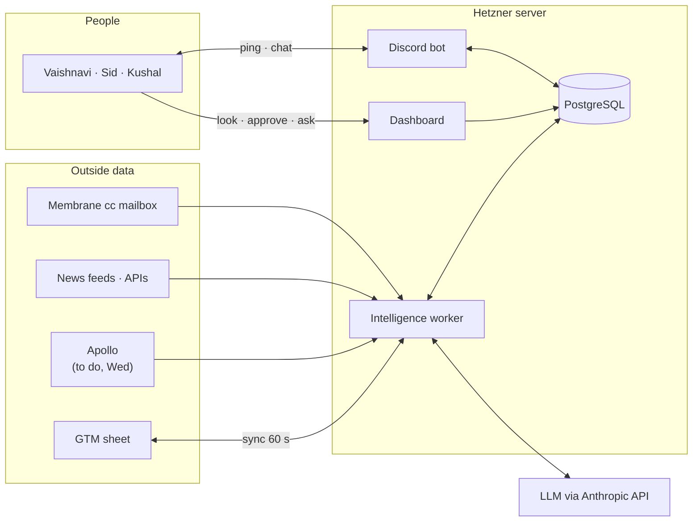

Data comes in from the left. The worker cleans it, thinks, and stores proposals. People see them on the dashboard or get a ping. A yes goes back to the sheet.

## 02 · Containers on the server

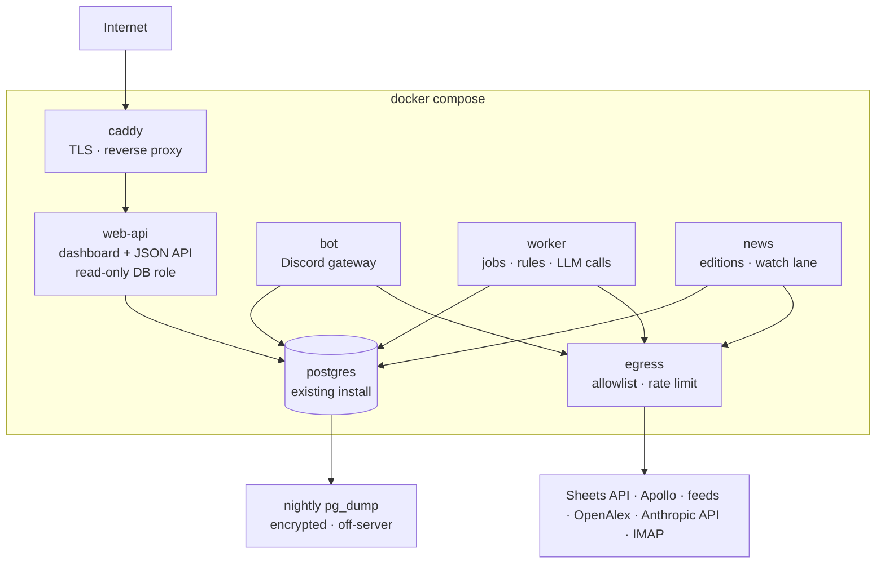

| Container | Does | Talks to | RAM |
| --- | --- | --- | --- |
| caddy | HTTPS in. Routes to web-api. | web-api | 50 MB |
| web-api | Serves the dashboard. Reads views. One write: decide. | postgres (read role), worker (decide queue) | 300 MB |
| bot | Discord in and out. Pings. Answers tags. | postgres, worker queue | 200 MB |
| worker | Sync, rules, facts, proposals, sheet writes, metrics. | postgres, egress | 500 MB |
| news | Pulls 94 sources, cleans, stores stories. | postgres, egress | 300 MB |
| egress | Only door to the internet. Allowlist. Per-host rate limit. | internet | 50 MB |
| postgres | Already on the server. One new database `saley`. | all | shared |

## 03 · Web + API

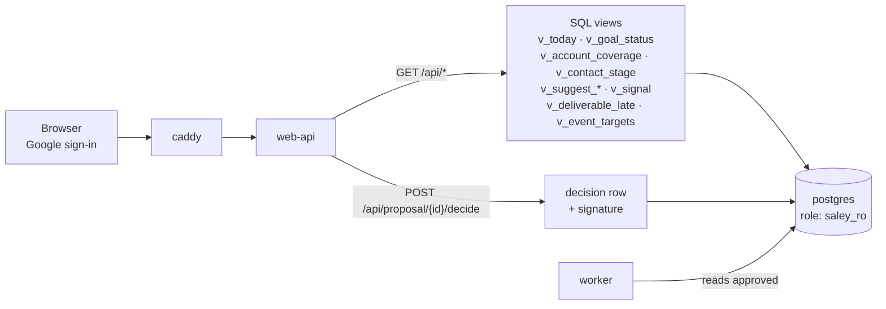

* Fourteen views in the dashboard. Each view = one endpoint = one SQL view.
* Roles: viewer, approver. Approvers: Kushal, Sid, Vaishnavi. Trishi: admin.
* Every decision stores: who, when, surface = dashboard.

## 04 · Bot

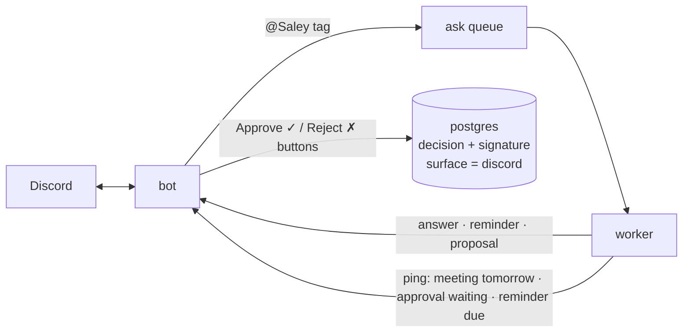

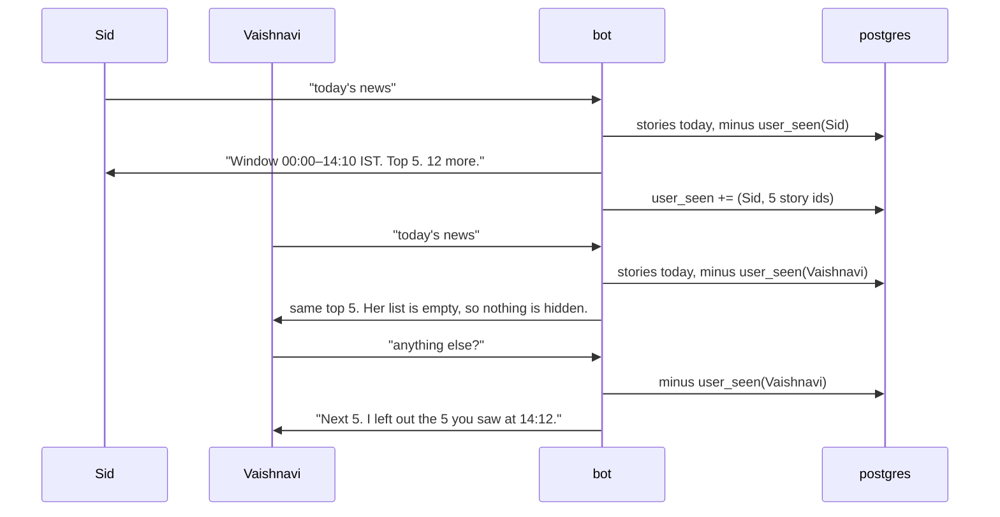

Seen is per person, not per channel. Every answer states its time window and how many items were left out as already seen.

* The bot does three things: ping, chat, approve. No schedule of its own.
* Per-user seen applies to every query answer: news, people lists, suggestions, reminders.
* Caps: 3 posts a day, 2 h gap, weekend silence. Meetings and reconnects are the exception.
* Instructions only from the allowlist. Everyone else gets answers.

## 05 · Worker: Intelligence

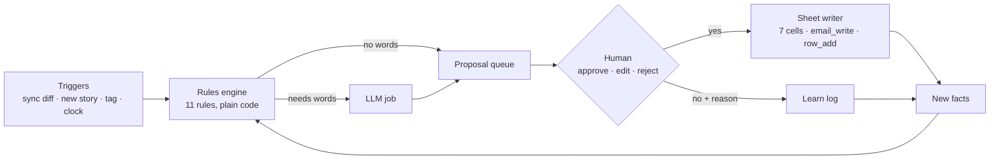

Rules decide. The LLM only reads and writes words. Humans approve. The loop learns from rejections.

| Job | When (IST) | Output |
| --- | --- | --- |
| sheet\_sync | every 60 s | entities, touches, stage\_log |
| rules\_tick | every 5 min | proposals, reminders |
| signal\_match | after each news edition | signals |
| working\_on\_refresh | 05:00, 1/7 of contacts | facts |
| mail\_read | every 10 min | replies, bounces, meeting notes → facts |
| apollo\_pull | weekly + on demand · to do, Wed 22 Oct | candidate companies and people |
| daily\_brief | 08:30 | Discord: top 5 + count |
| metrics\_snapshot | 23:50 | metric rows |
| weekly\_pack | Mon 14:00 | pack page + Discord summary |
| expire | 00:30 | expired facts and proposals |

## 06 · News module

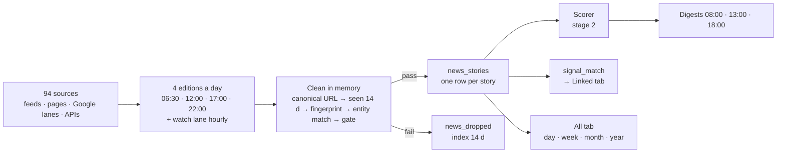

Details are in Saley News Plan v3. Here it is one box that feeds the Intelligence worker.

## 07 · Apollo pipeline

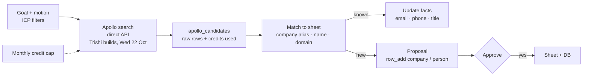

* Serves R02, R06, R11, S07–S09 and Part E of the requirements.
* Nothing lands in the sheet without a yes. Credits are counted per month.
* Apollo MCP is not used. It costs too much today. Until Wednesday the flow is marked To do, and R02 / R06 use news, papers, event pages and web search only.

## 08 · Sheet sync

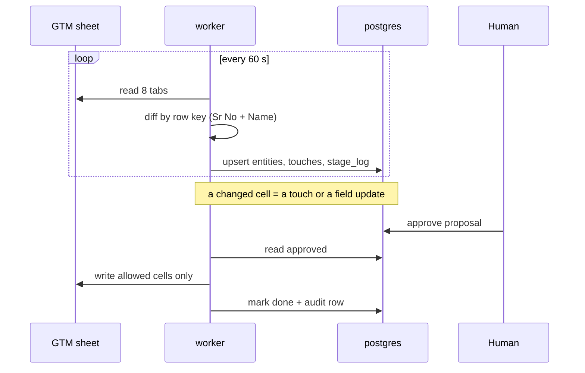

* Sheet wins on identity, step and commercial columns. DB wins on derived fields.
* Allowed writes: First Contact, First Contact Type, First Contact Date, Sid - LI Addition, LI Connected Date, Meeting Date, Meeting Status. Plus Email via `email_write` and new rows via `row_add`. Plus Stage, Motion, Goal after D6.
* First migration is reviewed: diff report, human fixes, then cutover.
* One sheet read = one snapshot with a `sync_id` (`sheet_snapshot.id`). A new snapshot is made only when the sheet changed. Every API request reads one snapshot in one read-only transaction and returns its `sync_id`. A stale `?sync_id=` gets 409 "Data changed. Reload the page." (D40)
* Headers are found by name, never by letter. A required header that is missing or renamed stops that tab only: its last good data stays, `sheet_tab_status` marks it stale, and Sources and health shows a red line with the header. The other tabs sync. Outreach PoCs depends on Master Pipeline. Unknown headers are listed as "new columns". (D41)

## 09 · Egress proxy

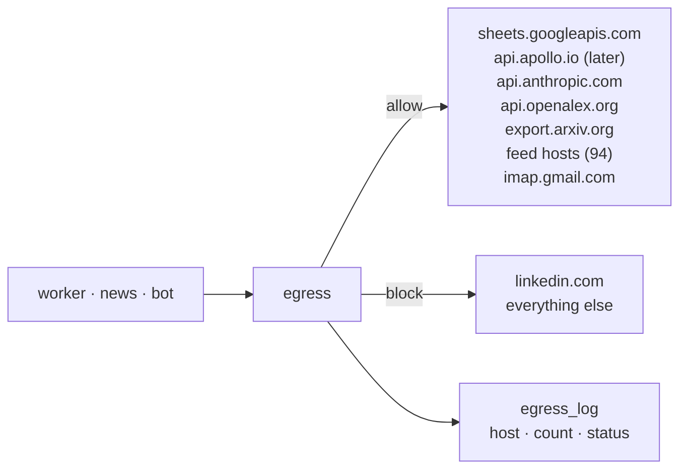

One door out. Per-host rate limits stop blacklisting. The log feeds the health view.

## 10 · LLM

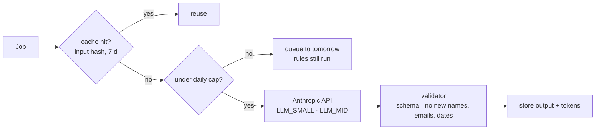

| Job | Calls / day | Model |
| --- | --- | --- |
| action\_hint, rank\_reason, working\_on | ≤ 210 | small |
| draft, answer, note\_extract, mail\_extract | ≤ 100 | mid |
| brief, pack, replan | ≤ 3 | mid |
| **Total** | ≈ 310 | ≈ 0.8 M in · 50 k out tokens |

## 11 · Database: what it stores

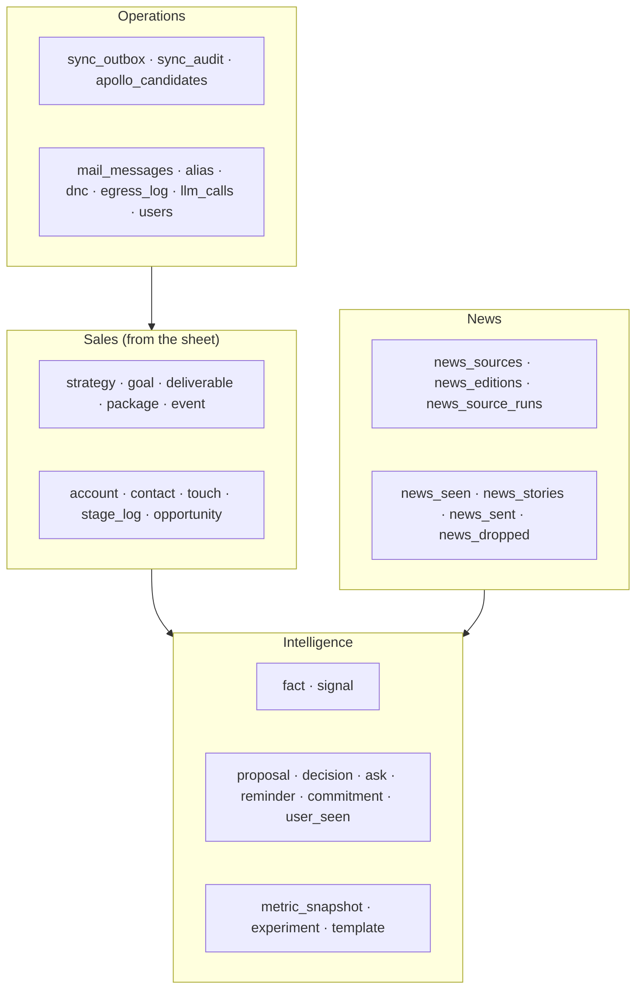

| Group | Tables | Holds | Written by |
| --- | --- | --- | --- |
| Sales | 10 | Mirror of the 8 sheet tabs plus derived stage and deal rows | sheet\_sync, approved writes |
| Intelligence | 10 | What Saley knows, proposes, asks, remembers, measures, and what each person has seen | worker, humans (decide) |
| News | 8 | Sources, pulls, stories, what was sent, what was dropped | news container |
| Operations | 9 | Sync queue and audit, Apollo raw, mail, aliases, do-not-contact, logs, users | worker, bot, web-api |
| **Total** | 37 | One database `saley`. Three roles: `saley` (worker, news, bot; read-write rows), `saley_ro` (web-api; read-only, views only for personal data), `saley_admin` (migrations, owns the schema). Created by `deploy/sql/roles.sql`. | |

## 12 · Schemas and relations

### 12.1 Sales

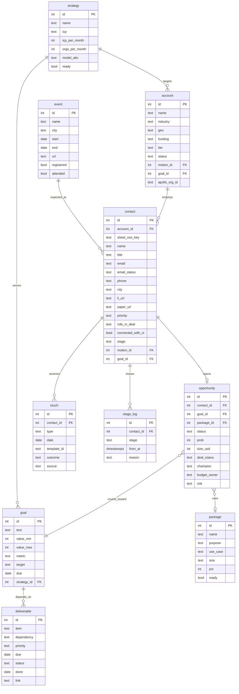

`contact.stage` is derived on every sync. `touch.type` ∈ li\_req, li\_accept, email1, email2, email3, li\_dm, call, meeting, reply, bounce.

### 12.2 Intelligence

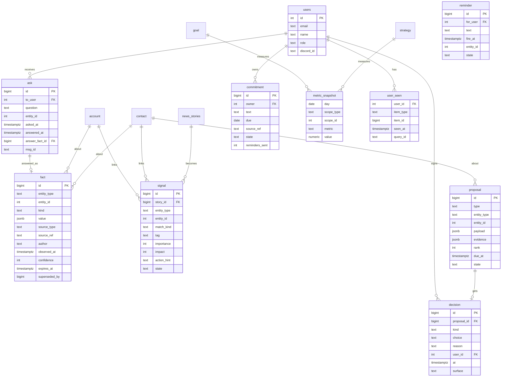

`user_seen` records what each person was shown, by item type (story, contact, suggestion). Queries subtract it per user. `decision` is the signature table. Every approval, edit, reject and strategy decision has one row: who, when, where. `decision.kind` ∈ proposal, strategy\_decision, column\_write.

### 12.3 News

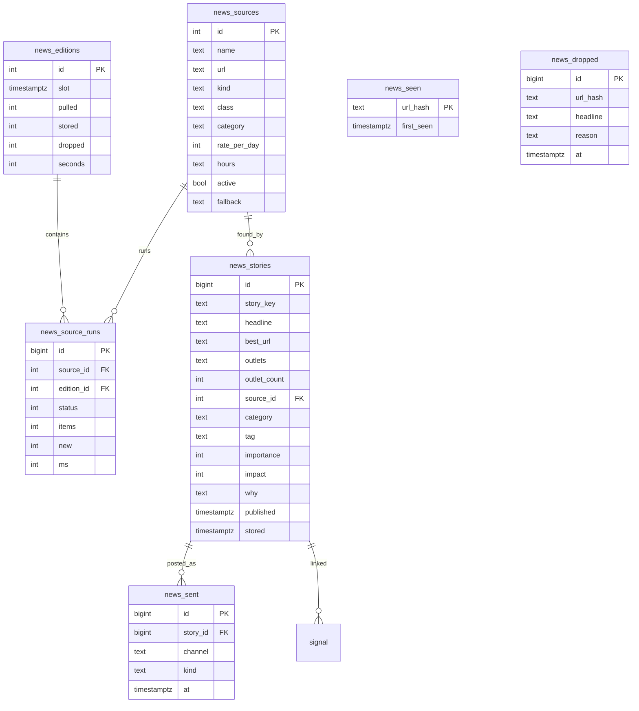

### 12.4 Operations

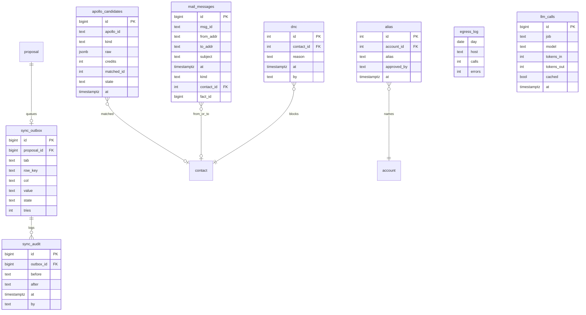

## 13 · Sizes and retention

**~1 k**contacts today

**~300**accounts

**~2 k**stories per month

**~50 k**facts per year

**< 2 GB**database after 1 year

| Table group | Retention | Size after 1 year |
| --- | --- | --- |
| Sales | Forever. History in stage\_log and touch. | ~20 MB |
| fact | 1 year. Superseded rows kept. | ~100 MB |
| signal, proposal, decision | 1 year | ~50 MB |
| user\_seen | 90 days | ~5 MB |
| metric\_snapshot | Forever. ~60 rows a day. | ~5 MB |
| news\_stories | 90 days. Sent stories 1 year. | ~300 MB |
| news\_seen, news\_dropped | 14 days | ~20 MB |
| news\_raw\_debug | 48 h, off in prod | 0 |
| mail\_messages | Headers 1 year. Bodies not stored. Facts extracted. | ~10 MB |
| apollo\_candidates | Raw JSON 90 days. Matched ids forever. | ~50 MB |
| llm\_calls, egress\_log | 90 days | ~30 MB |

## 14 · Cost estimate

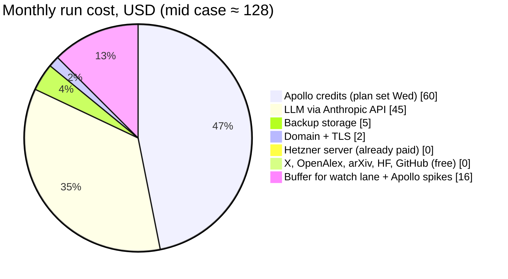

| Item | Low / month | Mid / month | High / month | Note |
| --- | --- | --- | --- | --- |
| Hetzner server | $0 | $0 | $0 | Existing. Adds ~1.5 GB RAM, ~2 GB disk. |
| LLM (Anthropic API) | $15 | $45 | $90 | ≈ 310 calls/day. Small model for 2/3 of calls. |
| Apollo credits | $0 (not used yet) | $60 | $120 | Direct API plan. Decided Wed 22 Oct. Apollo MCP not used: too costly. Cap in D9. |
| Backup storage | $3 | $5 | $8 | Object storage, 20–50 GB encrypted. |
| Domain + TLS | $1 | $2 | $2 | Caddy gets certificates free. |
| Free APIs | $0 | $0 | $0 | OpenAlex, arXiv, HF, GitHub, X public, Google News RSS. |
| Jev scorer (stage 2, optional) | $0 | $1 | $3 | $0.042 per M tokens. |
| **Total** | **≈ $19 today** | **≈ $113–128** | **≈ $223** | Apollo is the only line that can jump. Today it is $0. |

One-time: about 6–7 weeks of build (section 16). No new hardware.

## 15 · Security in one picture

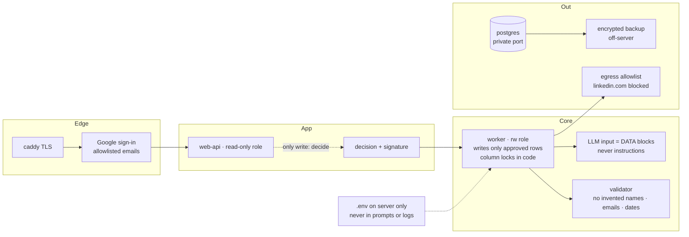

## 16 · Build order

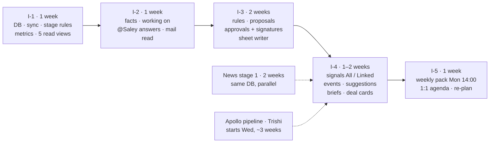

* After I-1: read-only views from real data. After I-3: approvals end to end. After I-5: the full dashboard. About 6–7 weeks in total.
* No Apollo until the direct pipeline lands. Suggestions run on sheet, news and papers until then.

Companion pages: Saley v2 — Requirements (doc) · Saley Intelligence SD · Saley Dashboard Mock · Saley GTM Brain · Saley News Plan v3. Base: Hetzner design of 15 Oct 2026. Rules: CLAUDE.md in Trishi7/sales-bot.
