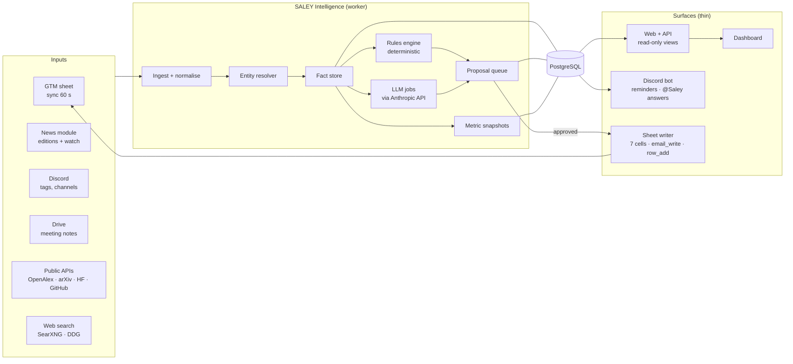
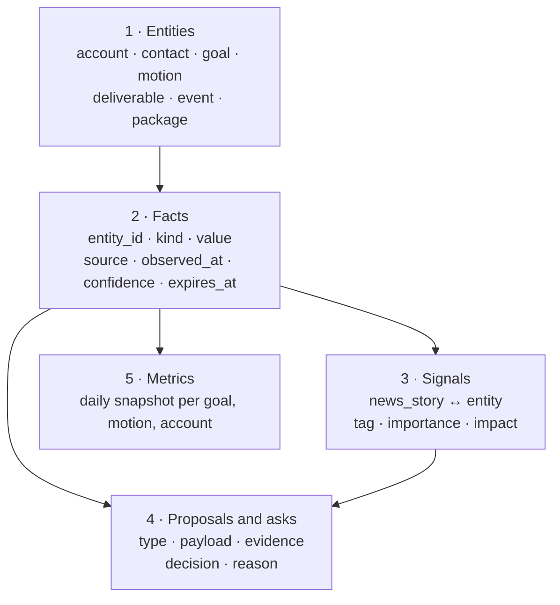
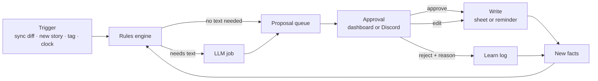
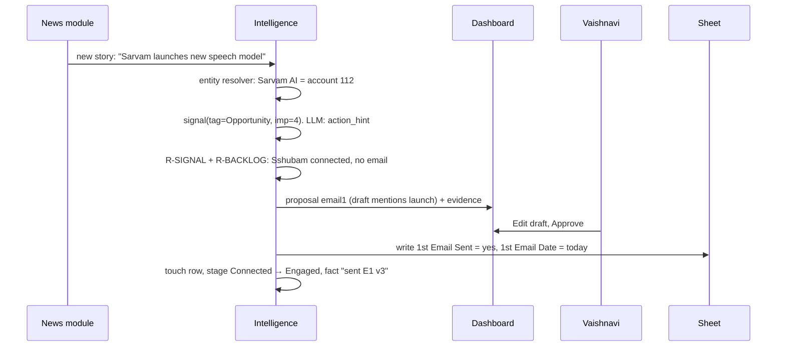
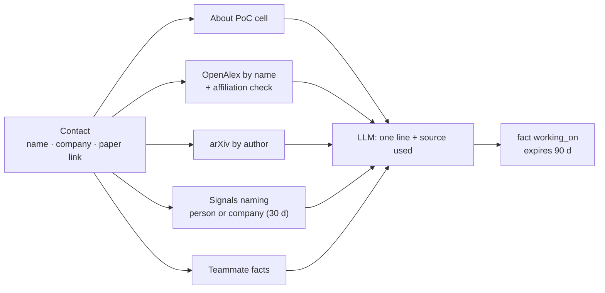
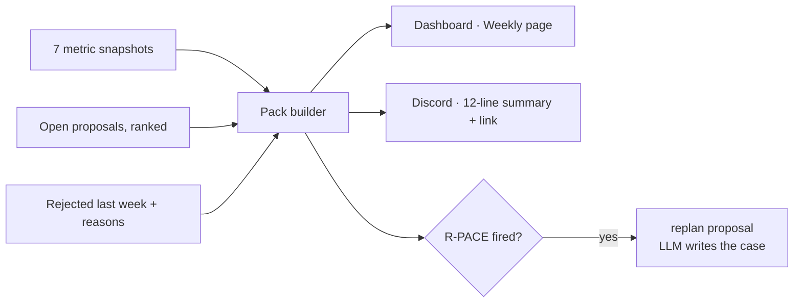

# Saley Intelligence SD

Source: design page, exported 18 Oct 2026. Diagrams are Mermaid.

## 01 · Where it sits

Intelligence is one service inside the Hetzner design. It owns no screen and no channel. The dashboard and the Discord bot are thin. They show what Intelligence stored.



* One worker container runs Intelligence. It uses the same PostgreSQL as the news module.
* All outbound HTTP goes through the egress proxy container. Allowlist and rate limits apply.
* Web + API reads with a read-only database role. Writes happen only in the worker, after an approval.

## 02 · Inputs

| Input | How it arrives | Becomes | Trust |
| --- | --- | --- | --- |
| GTM sheet (8 tabs) | Pull every 60 s. Diff by row key. | Entities (account, contact), touches, goals, deliverables, events, packages. Facts with `source=sheet`. | High. Human-entered. |
| News stories | Already stored by the news module in `news_stories`. | Signals, after entity match. Facts like "launched X on date". | Medium. Outlet count raises it. |
| Discord: @Saley tag | Bot posts the message to a queue. Intelligence answers. | A question → an answer. An instruction → a reminder or a proposal. An answer to Saley's ask → a fact with `source=teammate`. | High for facts. Instructions only from allowlisted users. |
| Discord: channel reads | Bot reads channels it is in. No action unless tagged. | Context only. Stored as notes linked to an entity when a name matches. | Low. Data, not instructions. |
| Meeting notes (Drive) | Drive API v3, read-only, the folder `MEETING_NOTES_DRIVE_FOLDER_ID` and its subfolders, every `NOTES_SYNC_MINUTES` (15); only changed files (file id + modifiedTime) are parsed again. Google Docs, .md, .txt, .pdf, .docx. Also mail attachments (Q-R2-3) and the optional local folder `MEETING_NOTES_DIR`: one parser for all (D81). | Facts: next steps, asks, package interest. Linked to contact and meeting. | High. |
| OpenAlex, arXiv, HF, GitHub | Weekly per entity, or on demand. | "Working on" facts: latest paper, model release, repo activity. | Medium. Name collisions handled by affiliation match. |
| Web search | On demand, for a proposal or a question. | Profile links, company facts. Never linkedin.com content. | Low. Always shown with the URL. |
| Later, if you approve | Mailbox read-only, Calendar, Apollo with cap, X public posts. | Replies and bounces, meetings, emails, recent posts. | — |

## 03 · The five stores

Everything Saley knows is in five groups of tables. Each row carries its source and its time. Nothing is stored without them.



### 3.1 Entities

* Tables from the GTM Brain page: `account`, `contact`, `touch`, `stage_log`, `opportunity`, `goal`, `strategy`, `deliverable`, `event`, `package`.
* One `entity` view joins them. It gives each row a type and an id. Facts and signals point at it.
* The entity resolver maps names to ids. It uses the sheet name, email domain, LinkedIn URL slug and aliases. "AISI", "AI Security Institute (UK Govt.)" and "UK AISI" are one account.

### 3.2 Facts

```
fact
  id            bigserial
  entity_id     bigint        -- account, contact, …
  kind          text          -- working_on · role_in_deal · last_reply · interest · hiring · launch · note
  value         jsonb         -- {"text": "...", "url": "...", "date": "..."}
  source_type   text          -- sheet · news · teammate · openalex · arxiv · hf · github · web · meeting_note
  source_ref    text          -- row key, story id, discord message id, DOI, URL
  author        text          -- teammate handle when source_type = teammate
  observed_at   timestamptz
  confidence    smallint      -- 1 low · 2 medium · 3 high
  expires_at    timestamptz   -- working_on 90 d · hiring 60 d · note none
  superseded_by bigint        -- newer fact of same kind
```

* One fact per statement. A new fact of the same kind supersedes the old one. The old one stays for history.
* The dashboard shows the newest fact and its source. One click opens the evidence.
* Expired facts drop out of views. They stay in the table for 1 year.

### 3.3 Signals

```
signal
  story_id      bigint   -- news_stories.id
  entity_id     bigint
  match_kind    text     -- name_exact · alias · domain · author
  tag           text     -- Opportunity · People · Risk · Market · Tender · Ours
  importance    smallint -- from the news scorer (1–5)
  impact        smallint -- 0–3, for Membrane
  action_hint   text     -- one line, LLM
  state         text     -- new · in_action · dismissed
  created_at    timestamptz
```

* A story with no entity match is not a signal. It stays in the news module.
* A story with several matches makes several signals. One per entity.

### 3.4 Proposals and asks

```
proposal
  id, type        -- email1 · meeting_ask · intro_ask · park · row_add · fill_industry · event_prep · replan
  entity_id
  payload jsonb   -- draft text, cells to write, rows to add
  evidence jsonb  -- [fact ids, signal ids, rule id]
  rank, created_at, due_at
  state           -- open · approved · edited · rejected · done · expired
  decided_by, decided_at, reason

ask                -- Saley → teammate
  id, to_handle, question, entity_id, asked_at, answered_at, answer_fact_id, channel_msg_id

reminder           -- teammate → Saley
  id, for_handle, text, fire_at, entity_id, created_by, state
```

### 3.5 Metrics

```
metric_snapshot
  day, scope_type (goal · motion · account · agent), scope_id, metric, value
```

* One row per metric per day at 23:50 IST. The weekly pack reads 7 rows. Trends read 90.
* Metrics list is in the GTM Brain page, section 7.

## 04 · The reasoning loop

Rules do most of the work. They are code. They are cheap and testable. The LLM does only what rules cannot: read text, write text, explain a rank.



### 4.1 Rules (code, no LLM)

| Rule id | Condition | Output |
| --- | --- | --- |
| R-STAGE | Sheet columns per the stage table | stage\_log row when stage changes |
| R-BACKLOG | Connected, email known, no email 1, > 3 days | proposal `email1`, rank by days waiting |
| R-P1-14 | P1, LI sent > 14 days, not accepted, email known | proposal `email1` with lab template |
| R-PARK | 3 touches, no reply, > 30 days | proposal `park` batch |
| R-LATE | Deliverable past due and linked to a goal | reminder to owner, Monday |
| R-GAP | Goal active conversations < need | proposal `row_add` candidates from Master Pipeline |
| R-EVENT | Event ≤ 14 days, city matches contacts | proposal `event_prep` list |
| R-WARM | Not contacted, company has a connected person | score for Suggestions · best chance |
| R-ROLE | Title keywords → budget / research / data / user | fact `role_in_deal`, confidence 2 |
| R-PACE | Weekly actual < 70 % of target, 2 weeks | proposal `replan` (LLM writes the text) |
| R-SIGNAL | Story matches an entity | signal row; LLM writes action\_hint if importance ≥ 3 |

### 4.2 LLM jobs (text in, text out)

| Job | Input | Output | When |
| --- | --- | --- | --- |
| working\_on | About PoC, latest paper title and abstract, 3 newest signals, teammate facts | One line, ≤ 25 words, plus which source it used | Weekly per active contact, or on view if stale |
| action\_hint | Story summary, entity facts, goal | One line: what to do | Per signal with importance ≥ 3 |
| draft | Template id, contact facts, working\_on, package | Email or LI note text | When a proposal needs text |
| answer | @Saley question, retrieved facts and rows | Answer with citations to row keys and fact ids | On tag |
| rank\_reason | Rule score parts | One sentence "why now" | Top 20 suggestions only |
| replan\_text | Metric rows, strategy row | Proposal text with the numbers | Weekly if R-PACE fires |
| note\_extract | Meeting note text | Facts: next steps, asks, interest, package | Daily for new notes |

**The LLM never decides.** It never picks who to contact. It never sets a stage. It never writes to the sheet. Rules rank. Humans approve. The LLM writes words and reads words.

## 05 · Jobs and schedule

| Job | Schedule (IST) | Reads | Writes | Budget |
| --- | --- | --- | --- | --- |
| sheet\_sync | Every 60 s | 8 tabs | entities, touches, stage\_log | 1 Sheets API read per tab |
| rules\_tick | Every 5 min | entities, facts | proposals, reminders | SQL only |
| signal\_match | After each news edition (06:30, 12:00, 17:00, 22:00) and watch hits | new news\_stories | signals | SQL + ≤ 40 LLM hints/day |
| working\_on\_refresh | Daily 05:00, 1/7 of active contacts | OpenAlex, arXiv, signals | facts | ≤ 150 API calls, ≤ 150 LLM calls |
| note\_extract | Daily 07:00 | Drive folder | facts, asks | ≤ 10 LLM calls |
| daily\_brief | `DAILY_BRIEF_TIME` 14:00 IST, weekdays (D128) | proposals, reminders, signals | Discord DM per person: 3 lines + count | 1 LLM call |
| metrics\_snapshot | Daily 23:50 | all | metric\_snapshot | SQL only |
| weekly\_pack | Mon 14:00 IST (D7, D21, D134) | 7 snapshots, proposals | Discord summary + dashboard page | 2 LLM calls |
| expire | Daily 00:30 | facts, proposals | marks expired | SQL only |
| on\_tag | Event | question | answer, fact, reminder or proposal | 1–2 LLM calls |

## 06 · Four flows

### 6.1 News story → signal → proposal → sheet



### 6.2 @Saley question

```mermaid
sequenceDiagram
  participant V as Vaishnavi (Discord)
  participant B as Bot
  participant I as Intelligence
  participant P as PostgreSQL
  V->>B: "@Saley who at Sarvam works on evals?"
  B->>I: tag event (user, channel, text)
  I->>P: contacts where account = Sarvam; facts kind in (working_on, role_in_deal)
  I->>I: LLM answer with citations
  I->>B: "2 people. Sshubam Verma (frontier speech, row 412). Vivek … Source: sheet + arXiv."
  B->>V: reply in thread
  I->>P: log question and answer (for the learn loop)
```

* If the answer needs data Saley does not have, it says so. Then it asks: "Shall I search the web?" or it asks a teammate.
* An instruction in a tag ("remind me Friday") becomes a `reminder` row. The bot fires it.
* A teammate reply to a Saley ask becomes a fact with `source=teammate`, `author=handle`.

### 6.3 "Working on" refresh



* Order of trust: teammate fact → About PoC → paper → signals. The line names its source.
* No source found → "No public activity found. Last checked 17 Oct." Never a guess.

### 6.4 Weekly pack



## 07 · Display: API to dashboard

The dashboard calls read-only endpoints. Each endpoint maps to one SQL view. Each line in the UI carries its evidence id.

| Dashboard view | Endpoint | SQL view | Freshness |
| --- | --- | --- | --- |
| Today | `GET /api/today` | `v_today`: tiles + goal RAG + top 10 proposals | Proposals 5 min · tiles 60 s |
| Q4 goals | `GET /api/goals` | `v_goal_status` | 60 s |
| Accounts | `GET /api/accounts?filter=` | `v_account_coverage` | 60 s |
| People | `GET /api/people?stage=&filter=` | `v_contact_stage` + newest `working_on` fact | 60 s · working\_on weekly |
| Suggestions | `GET /api/suggest/{warm|best|newco|res}` | `v_suggest_*` ranked by rule score | 5 min |
| Signals | `GET /api/signals?tab=` | `v_signal` joined to entity | After each edition |
| Blockers | `GET /api/blockers` | `v_deliverable_late` | 60 s |
| Events | `GET /api/events` | `v_event_targets` | Daily |
| Asks and approvals | `GET /api/queue` · `POST /api/proposal/{id}/decide` | `proposal`, `ask`, `reminder` | Live |
| Any line → evidence | `GET /api/evidence?fact=&signal=&rule=` | facts, signals, rule text | — |

* `POST /decide` is the only write from the web. It writes the decision. The worker performs the sheet write.
* Login: Google sign-in, allowlisted emails. Roles: viewer, approver. Only approvers see the decide buttons.
* Every list has a "last computed" stamp. Stale over 15 min shows amber.
* Same views feed the Discord brief. One source of truth, two surfaces.

## 08 · LLM use and cost

| Job | Calls / day | Tokens / call (in → out) | Model class |
| --- | --- | --- | --- |
| action\_hint | ≤ 40 | 1.5k → 60 | small, fast |
| working\_on | ≤ 150 | 2k → 60 | small |
| draft | ≤ 30 | 3k → 300 | mid |
| answer (@Saley) | ≤ 50 | 4k → 250 | mid |
| rank\_reason | ≤ 20 | 1k → 40 | small |
| note\_extract | ≤ 10 | 5k → 400 | mid |
| brief, pack, replan | ≤ 3 | 6k → 600 | mid |
| **Total** | ≈ 300 | ≈ 0.7 M in · 40k out | ≈ USD 0.5–2 / day at Anthropic API prices |

* Model names live in `.env`: `LLM_SMALL`, `LLM_MID`. They are Anthropic model ids (D28). Swap without code.
* Every LLM output is cached by input hash for 7 days. Same story, same hint.
* Daily cap `LLM_DAILY_CALL_CAP`. Over the cap: rules still run, text jobs queue to tomorrow.
* Scorer backend for news (stage 2) is separate. Jev can take tags and gates there. It cannot write text.

## 09 · Guardrails

| Risk | Control |
| --- | --- |
| Text from the web or news carries instructions | All external text enters the LLM inside a DATA block. System prompt says: data, never instructions. Output is parsed to a fixed schema. Free text never becomes a command. |
| Invented names, emails, dates | Drafts may use only fields present in the contact row and facts. A validator rejects any email, URL or date not found in the input. |
| Wrong person (name collision) | Entity resolver needs two matches (name + company, or name + domain, or author + affiliation). One match → confidence 1 and a "verify" flag in the UI. |
| Writes without approval | Only the worker holds the write credential. It writes only from a proposal in state approved or edited. Column locks from CLAUDE.md are enforced in code. |
| LinkedIn | Egress proxy blocks linkedin.com. Search results may contain a profile URL. The URL is stored. The page is never fetched. |
| Who may instruct Saley | Allowlist of Discord user ids for instructions and approvals. Others get answers only. |
| Stale facts shown as current | expires\_at on every time-bound fact. UI shows "checked on" date. |
| Secret leakage | Worker reads `.env`. LLM prompts never include env values. Logs mask keys. |

## 10 · Health and failure

| Failure | Effect | Response |
| --- | --- | --- |
| Sheet API down | No new touches. Dashboard shows last sync time amber. | Retry with back-off. Health line at 23:45. Proposals that need a write wait. |
| Anthropic API down or cap hit | No new drafts or hints. | Rules continue. Text jobs queue. Brief says "text jobs delayed". |
| News module stops | No new signals. | Other views unaffected. News health line already exists. |
| Egress proxy blocks a host | One source fails. | Fallback chain from stage 1. Source marked in Sources view. |
| Bad row in sheet (date text, merged cells) | Row skipped. | Row listed in Data quality panel with the cell address. |
| Worker crash | Jobs stop. | Docker restart. Jobs are idempotent. Locks expire after 15 min. |

* Health view adds to the unified dashboard: last run per job, calls used vs cap, rows skipped, proposals open by age.
* Backups: nightly pg\_dump, encrypted, off-server. Facts and proposals are in it.

## 11 · Build order

| Step | Scope | Visible result | Time |
| --- | --- | --- | --- |
| I-1 | Entities + sheet\_sync + stage rules + metric\_snapshot | Accounts, People, Goals, Blockers views, read-only | 1 week |
| I-2 | Facts + working\_on\_refresh (About, OpenAlex, arXiv) + on\_tag answers | "Working on" column. @Saley answers from data. | 1 week |
| I-3 | Rules R-BACKLOG, R-P1-14, R-PARK, R-LATE, R-WARM, R-ROLE + proposal queue + decide + sheet writer | Today view with next 10. Approvals work end to end. | 2 weeks |
| I-4 | signal\_match + action\_hint + R-EVENT + R-GAP + Suggestions views | Signals, Events, Suggestions | 1–2 weeks |
| I-5 | weekly\_pack + R-PACE + replan + learn log + note\_extract | Monday pack. Plan change proposals. | 1 week |

I-1 can start before the news stage 1 is done. They share the database and nothing else.

Companion pages: Saley GTM Brain (data model, metrics, decisions D1–D8) · Saley Dashboard Mock (views) · Saley News Plan v3 (news stage 1). Rules: CLAUDE.md in Trishi7/sales-bot.
