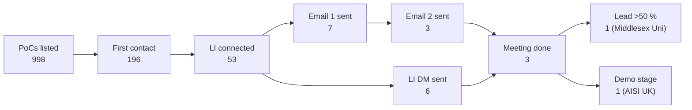
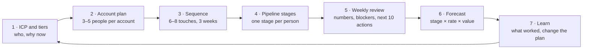
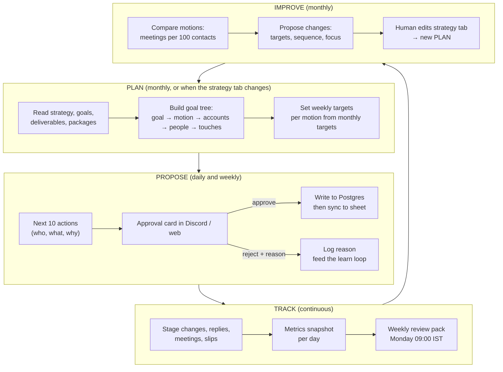
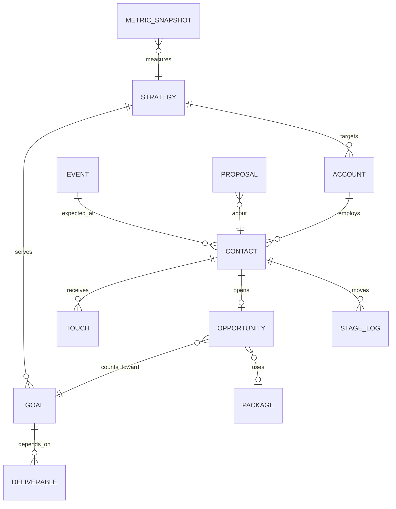

# Saley GTM Brain

Source: design page, exported 18 Oct 2026. Diagrams are Mermaid.

## 01 · What the sheet holds today

I read the live workbook. I used the five tabs you named. I also used three tabs that feed them.

| Tab | Rows | What it is | Role for Saley | State |
| --- | --- | --- | --- | --- |
| Sept2026\_Sales Strategy | 7 | Seven motions. ICP, targets per month, collaterals, first-deal timeline, success metrics. | The plan. Saley measures everything against it. | clean |
| Q4-OND2026-Goal Setting | 5 | Five Q4 goals. Value, metric, target, owner, dependencies, due date 31 Dec. | The targets. Saley reports distance to each goal. | 3 columns empty |
| Deliverables Checklist | 17 | Collaterals and legal items. Priority, deadline, status, remarks. | Blockers. Saley links each goal to the items it waits for. | dates in the past |
| Master Pipeline | 285 | Target companies. Industry, geography, funding. | Accounts. The universe Saley picks from. | no status, no owner |
| Outreach PoCs | 998 | People. 229 companies. Contact steps, emails, meetings, deal fields. New column Q. | Contacts and activity. The main working table. | deal fields almost empty |
| AI Events & Summits | 7 | Events. Date, place, key people, registered, attended. | Calendar. Saley reminds and prepares target lists. | clean |
| Sales Packages | 8 | Demo and off-the-shelf datasets. Purpose, size, % complete. | What we can offer. Saley matches a package to a PoC. | clean |
| Sales Funnel Mar–Jun 2026 | 6 verticals | Old funnel. 587 contacted, 185 connected, 18 positive, 9 meetings. | Baseline rates. Saley uses them to forecast. | history |

**Column Q answer.** Column Q in Outreach PoCs is `Connected with VR on LI`. It is a checkbox. All 998 rows are FALSE today. It is an identity/step column. Saley must read it. Saley must not write it. Put it in the next prompt as a read-only field.

## 02 · Insights the data gives today

These numbers come from the live sheet. Saley can produce all of them on demand in v2.

**998**PoCs in 229 companies

**196**first contact made (20 %)

**53**LI connected (27 % of sent)

**7**email 1 sent

**4**meetings done or set

**1**lead above 50 %

### 2.1 The funnel today (Sep–Oct 2026)

* The funnel breaks between **Connected** and **Email 1**. 53 people are connected. 48 of them have an email. Only 7 got email 1.
* 22 connected people wait with next step "Send email 1". 20 wait with "Research the PoC". This is the backlog Saley must clear first.
* Connect rate is 27 % (53 of 195 sent). The Mar–Jun baseline was 32 % (185 of 587). The rate holds.
* The old funnel gave 3 % positive and 1.5 % meetings. At that rate, one deal needs about 300–400 new contacts. The Q4 goals need 3 deals. The pace today is about 60 first contacts per week.

### 2.2 Pace

| Week | First contacts | Note |
| --- | --- | --- |
| W34 (18 Aug) | 5 | Start |
| W37–W38 | 4 | Quiet |
| W40 (28 Sep) | 40 | Sheet restructured |
| W41 (5 Oct) | 91 | Peak |
| W42 (12 Oct, partial) | 50 | On track for ~70 |

* The strategy tab asks for 5 ICPs and 2 orgs per month per motion. That is about 28 ICPs per month in total.
* The team does 60–90 per week. Volume is not the problem. Follow-through is the problem.

### 2.3 Where the effort goes

| Industry (PoCs) | Listed | Contacted | % | Q4 goal it serves |
| --- | --- | --- | --- | --- |
| AI Voice Agents | 205 | 74 | 36 | Goal 3 (Hinglish STT/TTS) |
| AI Labs | 167 | 80 | 48 | Goals 1, 2, 4 |
| Academia | 143 | 24 | 17 | Goal 5 |
| AI Voice/Productivity | 25 | 13 | 52 | Goal 3 |
| Consumer AI apps (content, dating, shopping, health, …) | 184 | 2 | 1 | Phase 2 |
| No industry set | 274 | 3 | 1 | Unknown |

* P1 is set on 51 people. 39 of them have an LI request sent and not accepted. 27 have no next step. Saley should chase these first.
* P1 companies: OpenAI 13, AISI UK 13, Anthropic 8, DeepMind 6. Four accounts hold 40 of 51 P1 people. This is account-based selling in practice. The sheet does not model it.
* Academia has 143 people and 17 % contact. Goal 5 needs one research team by 31 Dec. Timeline in the strategy tab is 3–4 months. The clock is tight.
* 274 people have no industry. Saley cannot route them to a goal. A cheap fix: fill industry from the company row in Master Pipeline.

### 2.4 Readiness

* Six of seven motions say "Are all ready? = No". The same item blocks five of them: **Pulse Product Overview Document**. It is P1, due 30 Sep, still in progress.
* All five Q4 goals depend on "Legal compliances". NDA and MSA are "Not started". NDA was due 18 Sep. MSA was due 9 Oct. SoW template waits for MSA.
* Three of eight packages are complete. Hinglish STT training set is 33 %. Image A/B and Image-to-Prompt are not started.
* Of seven events, one is attended (GPT-6 night). Four London events fall in Oct–Nov. Registration is "not available" on five rows.

## 03 · What is missing

Saley can plan only with data that exists. These gaps stop it.

| Gap | Why it matters | Fix | Who |
| --- | --- | --- | --- |
| No stage field per PoC | Stage is spread over 12 columns. "Where is this person?" needs rules, not a lookup. | Add one `Stage` column, or let Saley derive it (section 6). | Vaishnavi / Saley |
| No link from PoC to a goal or motion | Saley cannot say "Goal 1 has 12 active conversations". | Add `Motion` (1–7) and `Goal` (1–5) per PoC. Default by industry. | Saley proposes, human confirms |
| Master Pipeline has no status or owner | 285 accounts, no "working / parked / lost". | Add `Account status`, `Owner`, `Tier`. | Vaishnavi |
| No reply log | "Replied" exists only in LI DM Sent. Email replies and bounces are not stored. | Add `Last reply date`, `Reply type` (positive / neutral / no / bounce). | Sid / Saley reads mail later |
| No "why" on outcomes | Rejections have no reason. Saley cannot learn which message works. | Add `Outcome reason` list. | Sid |
| Deal fields are empty | Status, Closure %, Deal size filled on 1–4 rows. | Fill for every meeting. Saley asks after each meeting. | Sid, Saley reminds |
| Goal tab: "Total Leads", "Status" empty | No live count against target. | Saley fills these from PoC rows after a rule you approve. | Saley |
| Deliverables: no done date, deadlines past | Saley cannot measure slip. | Add `Done date`. Move dates or mark "Re-planned". | Owner of each item |
| Events: no target list per event | "Who do we meet there?" is not stored. | Saley builds a list from PoCs by city and date. | Saley |
| Packages not linked to PoCs | "Which demo for whom?" is manual. | Add `Package` use on PoC rows (column exists, empty). | Saley proposes |
| Dates in two formats | "02.09.2026" text and real dates mix. | Normalise on import. Saley flags bad cells. | Saley |
| Message text not stored | Which email 1 was sent is unknown. | Store template id per touch. | Saley |

## 04 · How similar companies run sales

Membrane sells human-data services to AI teams. Comparable companies: Scale AI early days, Surge AI, Prolific, Toloka, Labelbox services, Karya, Sarvam data partners. Their sales is founder-led, high-touch, low-volume. The pattern is the same in all of them.

### 4.1 The seven practices

1. **ICP and tiers.** Tier 1 = can sign a $30–50k SoW this quarter. Tier 2 = can pilot. Tier 3 = can refer. Each tier gets a different effort level. You have this in spirit (P1/P2). It is set on 6 % of rows.
2. **Account plan, not person plan.** For a Tier 1 account, map 3–5 people: budget, research, user, champion. Work them together. Your P1 list already does this for OpenAI, AISI, Anthropic, DeepMind. The New AI Verticals tab has a "Role in Deal" column. Outreach PoCs does not.
3. **Fixed sequence.** Example: LI request → LI note on accept → email 1 (day 0) → email 2 (day 4) → LI DM (day 7) → email 3 (day 12) → park 60 days. Every touch has a template id. Your sheet has the steps. It does not have the timing. Saley can own the timing.
4. **One stage per person.** Stages are exclusive. A person is in exactly one. Common set: `Listed → Contacted → Connected → Engaged → Meeting → Qualified → Proposal → Won / Lost / Parked`. Stage changes are logged with a date. This gives velocity and conversion.
5. **Weekly pipeline review.** 30 minutes. Same numbers each week. New contacts, connects, replies, meetings, stage moves, slipped items, next 10 actions. The agent prepares it. Humans decide.
6. **Forecast by stage.** Weighted value = deal size × stage probability. Stage probability comes from history, not from feeling. With 9 meetings in the baseline you cannot trust the rate yet. Start with fixed numbers and let data replace them.
7. **Learn loop.** Monthly: which motion gave meetings per 100 contacts? Which template got replies? Which industry converts? Move effort to the winner. This is "keep improvising the plan".

### 4.2 Three operating models to choose from

Option A

#### Volume funnel

Many contacts, fixed sequence, measure rates. Agent optimises for replies per 100 contacts.

**Fits:** Voice AI startups, consumer apps.  
**Risk:** Frontier labs ignore volume outreach.

Option B

#### Account-based

10–15 named accounts. 3–5 people each. Custom demo per account. Agent tracks coverage and warmth per account.

**Fits:** Goals 1, 2, 4 (labs), Goal 3 (sovereign model).  
**Risk:** Slow. Needs the Overview doc and packages ready.

Option C

#### Product-led pilot

Free credits, self-serve dashboard, demo dataset first. Agent tracks sign-ups, first pulse, paid conversion.

**Fits:** Academia (Goal 5), researchers, small labs.  
**Risk:** Dashboard demo and credits are not ready.

**My suggestion.** Run B for labs and sovereign models. Run C for academia. Run A only for Voice AI startups. Saley tags each PoC with the model. Saley measures each model with its own metrics. We decide this in section 8.

## 05 · Saley as sales strategist

The system design says: SALEY web + API with human-in-the-loop writes. Saley never acts alone. Saley reads, thinks, proposes. A human approves. Then Saley writes and tracks.

### 5.1 What Saley proposes, with the data it has today

| Proposal type | Trigger | Example from live data | Needs approval? |
| --- | --- | --- | --- |
| Clear the backlog | Connected, email exists, no email 1, >3 days | "22 connected people wait for email 1. Here are the first 10 with a draft each." | Yes, per email |
| Chase P1 | P1, LI sent >14 days, no accept | "39 P1 people have not accepted. Try email for the 31 with an address." | Yes |
| Fill the gap to goal | Goal has fewer active conversations than needed | "Goal 3 needs 1 deal. Active sovereign-model conversations: 0. Propose 8 accounts: Sarvam, Krutrim, BharatGen, …" | Yes (new rows) |
| Unblock | Deliverable past due that a goal depends on | "NDA is 29 days late. It blocks all 5 goals. Owner: legal. Ask Sid for a date." | No (reminder only) |
| Event prep | Event within 14 days | "AI LIVE London, 20–21 Oct. 92 PoCs are in London. 11 are connected. Propose 5 meetings." | Yes |
| Match a package | Meeting done, no package set | "ARTPARK meeting done. Low-resource language list requested. Hinglish STT package fits." | Yes |
| Park | 3 emails, no reply, 30 days | "Park 14 people. Reconnect date +60 days." | Yes (batch) |
| Re-plan | Weekly actuals < 70 % of target for 2 weeks | "Academic outreach: 6 contacts in 2 weeks vs 10 target. Move 2 h/week from Voice AI, or lower the target." | Yes (strategy change) |

### 5.2 What Saley never does

* Never sends an email or DM on its own. CLAUDE.md rule: every write goes through an approval proposal.
* Never writes identity, step or commercial columns on an existing row. Column Q joins this list.
* Never changes the strategy tab. It proposes a change. A human edits the tab.
* Never invents a contact, email, number or date. Every proposal cites the row it comes from.

## 06 · Data model and sync

PostgreSQL is the master in v2. The sheet stays the human interface. Sync runs both ways every 60 s. This section maps tabs to tables.

| Table | From tab | Key fields | Sheet → DB | DB → Sheet |
| --- | --- | --- | --- | --- |
| `strategy` | Sept2026\_Sales Strategy | id, name, icp, icp\_per\_month, orgs\_per\_month, collaterals, ready, first\_deal\_months, metric\_text, model (A/B/C) | Yes | No. Human owns it. |
| `goal` | Q4 Goal Setting | id, text, value\_min, value\_max, metric, target, owner, due\_date | Yes | Only `Total Leads`, `Status` |
| `deliverable` | Deliverables Checklist | id, item, dependency, priority, due, status, link, done\_date | Yes | No |
| `account` | Master Pipeline + company column of PoCs | id, name, industry, geo, funding, tier, status, owner, model | Yes | tier, status (new columns, approved) |
| `contact` | Outreach PoCs (identity columns) | id, account\_id, name, title, email, email\_status, city, li\_url, paper\_url, priority, connected\_with\_vr (Q) | Yes | Only Email cell via `email_write`, new rows via `row_add` |
| `touch` | Outreach PoCs (step columns) | contact\_id, type (li\_req, li\_accept, email1..3, li\_dm, meeting), date, template\_id, outcome | Yes. One row per filled step cell. | Yes. The 7 allowed cells only. |
| `stage_log` | Derived | contact\_id, stage, from\_date, reason | Derived on import | Optional `Stage` column |
| `opportunity` | Outreach PoCs (commercial columns) | contact\_id, goal\_id, package\_id, status, prob, size\_usd, deal\_status, notes | Yes | No. Human writes. |
| `package` | Sales Packages | id, name, purpose, use\_case, size, pct\_complete, ready | Yes | No |
| `event` | AI Events & Summits | id, name, city, date\_start, date\_end, url, registered, attended | Yes | No |
| `proposal` | — (Saley only) | id, type, contact\_id, payload, created, decided\_by, decision, reason | — | — |
| `metric_snapshot` | — (Saley only) | date, strategy\_id, goal\_id, metric, value | — | — |

### 6.1 Stage rules (derived, no new column needed)

Rules are checked top-down; the first match wins (decisions D29, D31, confirmed 18 Oct).

| Order | Stage | Rule from existing columns | Today (18 Oct) |
| --- | --- | --- | --- |
| 1 | Won | Deal Status says "won", "signed" or "closed won" | 0 |
| 1 | Lost | Deal Status says "lost", "dead" or "closed lost", or Closure Prob = 0 % | 0 |
| 2 | Qualified | Status is "lead", "demo", "quote" or "deal", or Closure Prob ≥ 50 % ("<50%" counts as below 50) | 4 |
| 3 | Meeting | Meeting Date set or Meeting Status set | 0 |
| 4 | Parked | Reconnect Date set (only reached below Meeting) | 0 |
| 5 | Engaged | Any email sent or LI DM sent | 8 |
| 6 | Connected | Sid - LI Addition = Connected | 41 |
| 7 | Contacted | First Contact = TRUE (checkbox; "VR" / "Sid" text also counts) | 143 |
| 8 | Listed | none of the above | 528 |

Words match as whole words and not when negated ("Not won", "Unsigned", "not a lead", "won't").

Saley computes the stage on every sync. If you later add a `Stage` column, Saley fills it and a human can override it.

### 6.2 Sync rules

* Import every 60 s. Compare by row key (Sr No + Name). Changed cells become `touch` or field updates.
* Sheet wins on identity, step and commercial columns. DB wins on derived fields. Conflict on an allowed cell: newest timestamp wins, both values logged.
* First migration is reviewed. Saley produces a diff report: bad dates, duplicate people, missing industry, emails that fail format. A human fixes or accepts. Then the DB becomes master.
* Writes from DB to sheet stay inside the 7 allowed cells, `email_write` and `row_add`. New columns (Stage, Tier, Motion, Goal) need your approval before Saley writes them.

## 07 · Metrics Saley tracks

Two kinds. Leading metrics predict. Lagging metrics confirm. The weekly pack shows both.

| Level | Metric | Formula | Target source | Today |
| --- | --- | --- | --- | --- |
| Motion | New ICPs contacted / week | count(touch.type = first\_contact, week) | strategy.icp\_per\_month ÷ 4.3 | ~60 all motions |
| Motion | New orgs touched / week | distinct account with first touch | strategy.orgs\_per\_month ÷ 4.3 | n/a (no motion tag) |
| Motion | Connect rate | connected ÷ LI requests sent | baseline 32 % | 27 % |
| Motion | Reply rate | replies ÷ email 1 sent | baseline 3 % | unknown (no reply log) |
| Motion | Meetings per 100 contacts | meetings ÷ contacted × 100 | baseline 1.5 | 1.5 |
| Motion | Follow-up lag | days from Connected to email 1 | ≤ 3 days | most rows: open |
| Goal | Active conversations | contacts in Engaged+ linked to goal | goal.target (e.g. 2–3 for Goal 4) | G4: 2 (AISI, Middlesex) |
| Goal | Weighted pipeline USD | Σ size × prob | goal.value\_min | ≈ 0 (fields empty) |
| Goal | Days to due | due\_date − today | 31 Dec | 75 |
| Goal | Blocking deliverables open | count(deliverable late and linked) | 0 | NDA, MSA, Overview doc |
| Account | Coverage | people contacted ÷ people mapped (Tier 1) | ≥ 3 per account | OpenAI 13 mapped |
| Account | Warmth | max stage across people | Meeting by month 2 | AISI: Demo |
| Event | Meetings booked per event | count(meeting within ±2 days, same city) | strategy row 7 | 0 |
| Agent | Proposal accept rate | approved ÷ proposed | > 60 % | new |
| Agent | Actions closed on time | done ÷ proposed within SLA | > 80 % | new |

### 7.1 Weekly review pack (Monday 09:00 IST, Discord + web)

* Scoreboard: 5 goals, each with active conversations, weighted USD, days left, blockers. Red / amber / green.
* Funnel this week vs last week. Contacts, connects, emails, replies, meetings.
* Motion table: target vs actual, meetings per 100.
* Backlog: connected without email, P1 not accepted, meetings without a package, parked due for reconnect.
* Slips: deliverables past due, with owner.
* Next 10 actions with an approve button each.
* One suggestion to change the plan, with the numbers behind it.

## 08 · Decisions for you

| # | Decision | Options | My suggestion |
| --- | --- | --- | --- |
| D1 | Operating model per segment | A volume · B account-based · C pilot-led | B labs and sovereign, C academia, A voice startups |
| D2 | Stage: derived or a new column | Derived only · New column Saley fills · New column human fills | Derived now. Column in v2 after migration. |
| D3 | Tag PoCs to Motion and Goal | Saley proposes by industry, human confirms · Manual | Saley proposes, one batch approval per industry |
| D4 | Sequence timing | Fixed days (0 / 4 / 7 / 12) · Per motion · Manual | Fixed now. Per motion after 2 months of data. |
| D5 | Reply log source | Human marks in sheet · Saley reads a sales mailbox (read-only) · Both | Human marks now. Mailbox read in stage 3 of v2. |
| D6 | New columns Saley may write | None · Stage, Motion, Goal · Also Tier, Account status | Stage, Motion, Goal. Human writes Tier. |
| D7 | Weekly pack day and place | Monday 09:00 IST · Friday 17:00 · Both | Monday 09:00, Discord summary, full pack on web |
| D8 | Plan change authority | Saley proposes only · Saley edits targets within ±20 % | Proposes only. Human edits the tab. |

### Suggested order of work (v2, GTM part)

1. Reviewed migration: import the 8 tabs to Postgres. Diff report. Fix data. (1 week)
2. Stage rules, motion and goal tags, metric snapshots. Weekly pack read-only. (1 week)
3. Proposals with approval cards: backlog, P1 chase, park, event prep. Writes through the sync. (2 weeks)
4. Goal-gap proposals and re-plan suggestions. Learn loop. (2 weeks)

Numbers: live GTM Playbook export, 16 Oct 2026 10:58 UTC. Baseline rates: "Sales Funnel - March-June 2026" tab. Rules: CLAUDE.md in Trishi7/sales-bot. This page proposes. Nothing here changes the sheet.
